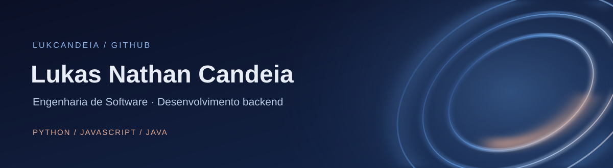
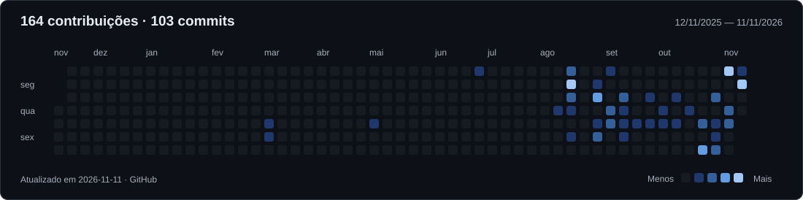

 

 

<h2 align="center">Sobre</h2>

Estudante de Engenharia de Software na PUC Minas. Desenvolvo projetos acadêmicos com foco em arquitetura de software, automação de processos e resolução de problemas, trabalhando em equipe ao longo do ciclo de desenvolvimento.

- Graduando em Engenharia de Software — PUC Minas (Fev/2026 – Dez/2029)
- Belo Horizonte, MG
- Prática contínua em algoritmos e estruturas de dados (LeetCode)

 

<h2 align="center">Tecnologias</h2>

<strong>Linguagens</strong>

  

<strong>Frameworks e bibliotecas</strong>

  

<strong>Bancos de dados</strong>

  

  

<strong>Ferramentas e ecossistema</strong>

  

  

 

<h2 align="center">Estatísticas</h2>

  
  

 

<h2 align="center">Calendário de contribuições</h2>

  

 

<h2 align="center">Atividade recente</h2>

  

 

<h2 align="center">Experiência</h2>

**Desenvolvedor (Projetos Acadêmicos) — PUC Minas**  
Fev/2026 – Presente

- Automação de sistemas: desenvolvimento de scripts e integração para bots de WhatsApp, otimizando fluxos de dados e comunicação.
- Engenharia de software: arquitetura, desenvolvimento e prototipagem de aplicações em equipe, cobrindo o ciclo SDLC, versionamento (Git/GitHub) e UI/UX design (Figma).

 

<h2 align="center">Formação acadêmica</h2>

**Bacharelado em Engenharia de Software**  
PUC Minas (Coração Eucarístico) — Fev/2026 – Dez/2029

